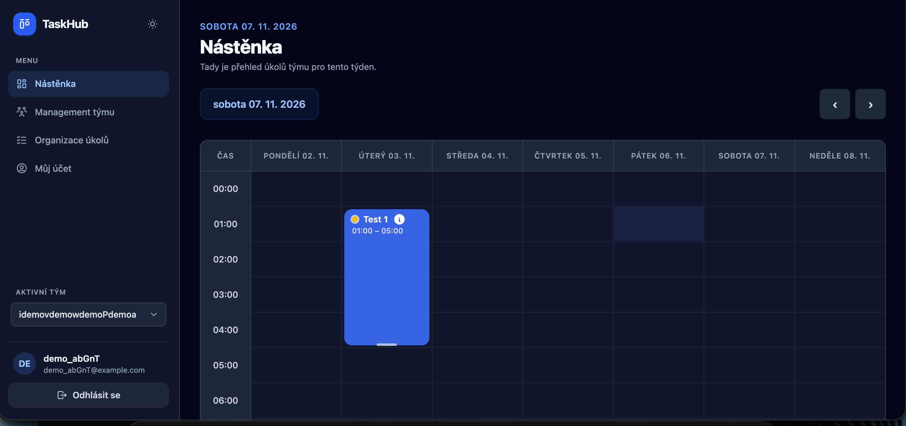
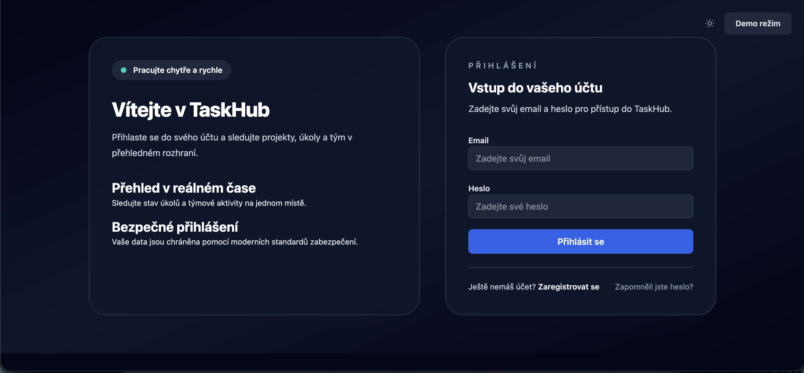

# TaskHub

A full-stack application for planning team work: created tasks are dragged into a weekly calendar, assigned to team members, and can be stretched across multiple hours. The project was built as a portfolio showcase.

**Live demo:** [taskhub.tomas-dev.cz](https://taskhub.tomas-dev.cz). On the login page, click **Demo režim** (Demo mode) and the app will create a temporary account with its own team for you, no registration required.

## Screenshots

**Dashboard** – weekly calendar with team tasks

**Login page**

## Tech stack

| Layer | Used |
|---|---|
| Frontend | Vue 3 (Composition API), Vue Router, Pinia, Tailwind CSS 4, Vite |
| Backend | Django 5, Django REST Framework, SimpleJWT |
| Database | PostgreSQL 15 |
| Infrastructure | Docker Compose, nginx (reverse proxy + TLS via Let's Encrypt), Gunicorn |
| CI/CD | GitHub Actions (tests against a Postgres service), Bash deploy script |

## Deployment

Production runs on a VPS via Docker Compose. The [deploys/deploy.sh](deploys/deploy.sh) script pulls the latest version, builds and restarts the containers, removes old images, and then checks up to 30 times that the site is responding. If it doesn't respond, it prints the backend logs.